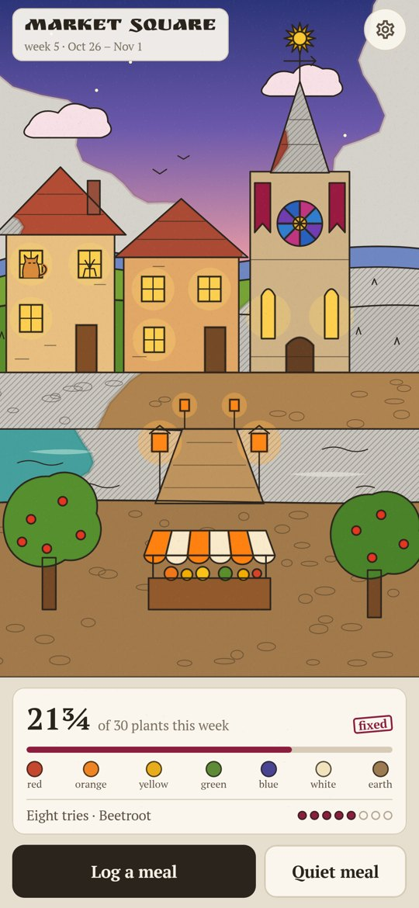
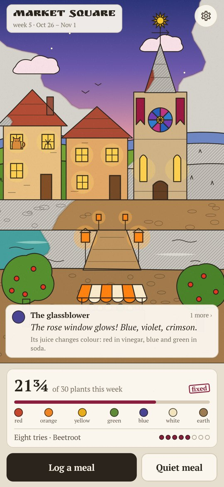
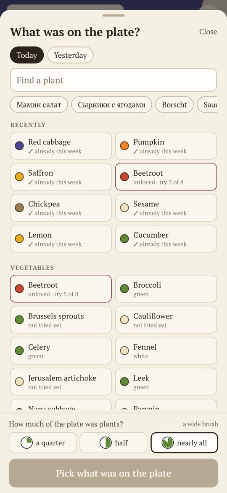
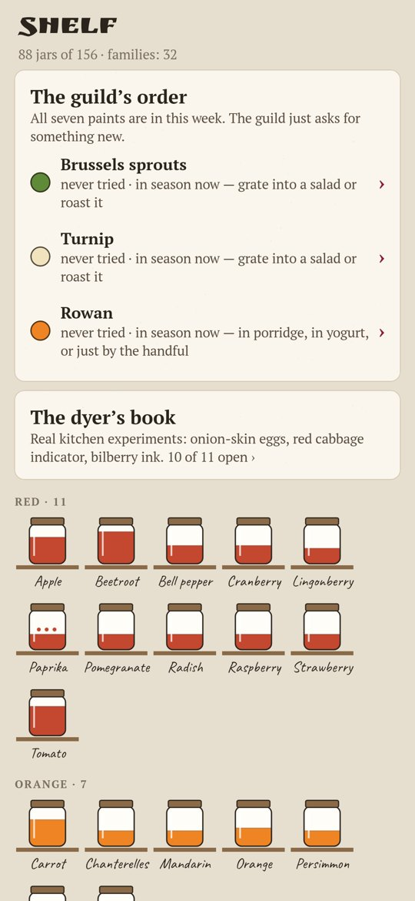
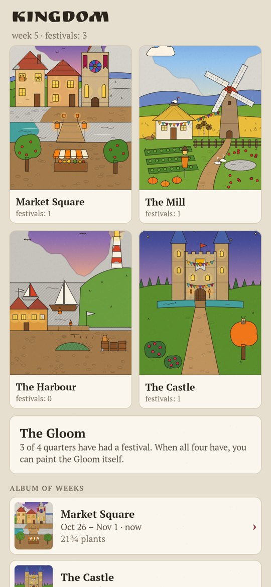

# Dyer

### Thirty plants a week repaint a faded kingdom

*The Grey Gloom drank the colours of a fairy-tale kingdom. You are the dyer's apprentice, and paint comes only from living plants: every different plant on your plate gives its pigment, and the week's quarter comes back to colour, in watercolour over ink. Thirty different plants in a week and the quarter throws a festival. No calories, no scales, no bans. Free, no ads, no account, no internet.*

**English** · [Русский](README.ru.md) · [Changelog](CHANGELOG.md)

    

**[Download the APK](https://github.com/bigdevwhale/dyer/releases/latest/download/Dyer.apk)** · Android 9+

---

## How it works

1. **One meal, one entry.** Pick everything that was on the plate and say once how much of it was plants: a quarter, half or nearly all. That sets the brush, thin to wide.
2. **Each plant paints a thing.** Tomato paints the roof tiles, bilberries the evening sky, onions light the windows, buckwheat and lentils lay the cobbles. Seven paints: red, orange, yellow, green, blue, white and earth.
3. **Drops and whitewash.** Herbs and spices count as a quarter, white rice and white bread as half. Kefir, sauerkraut and other fermented food fix the week's colours.
4. **Thirty a week.** Based on the American Gut finding that people eating 30+ different plants a week had more varied gut flora. In a hard week, choose the small brush of 15.
5. **Eight tries.** Take a plant you don't like into work: its paint starts muddy and clears with every meal it's in, because a new taste usually takes 8–15 tries.
6. **Quiet meal.** Phone face down, eat slowly: every twenty minutes the brush draws a small detail, a cat in a window, geese by the pond.
7. **The shelf and the kingdom.** Every plant ever eaten stands as a jar; the guild suggests three plants in season that the quarter lacks; the dyer's book opens real kitchen experiments (onion-skin eggs, red cabbage indicator, bilberry ink). Four quarters take turns week by week; once all four have had a festival, you can paint the Gloom herself.

## Under the hood

- Kotlin, Jetpack Compose, Room, DataStore, WorkManager. Everything stays on the phone.
- The quarters are drawn in code (`ui/art/Scenes.kt`) and painted by `ui/art/Painter.kt`: grey hatching, an uneven watercolour front spreading from each thing, ink on top.
- 170 plants with families, seasons and facts in `app/src/main/assets/plants.tsv`.
- `./gradlew assembleDebug -Pdemo` builds a demo with five weeks of history; `./gradlew testDebugUnitTest -Prender` draws every screen to `app/build/art`.

## License

MIT. Fonts: PT Serif, Ruslan Display and Caveat (SIL OFL).
