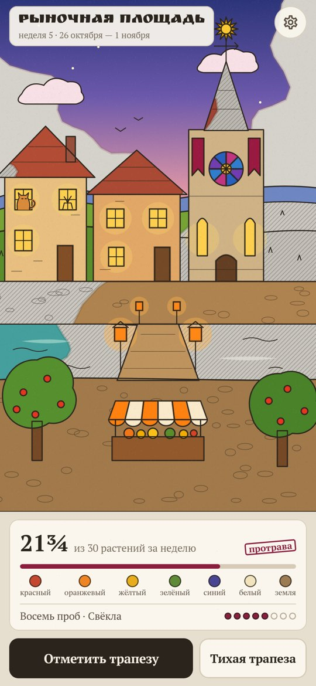
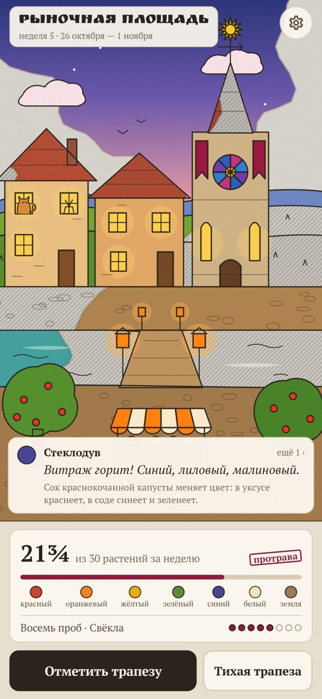
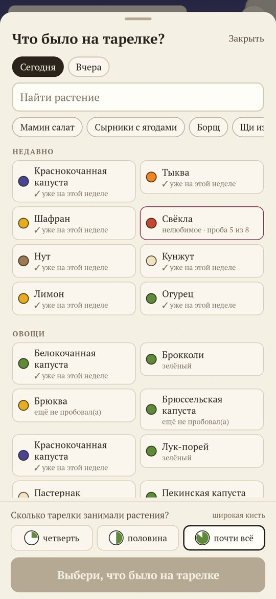
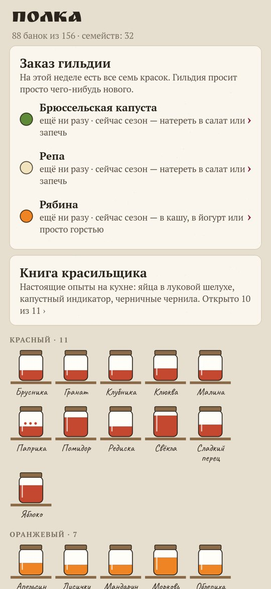
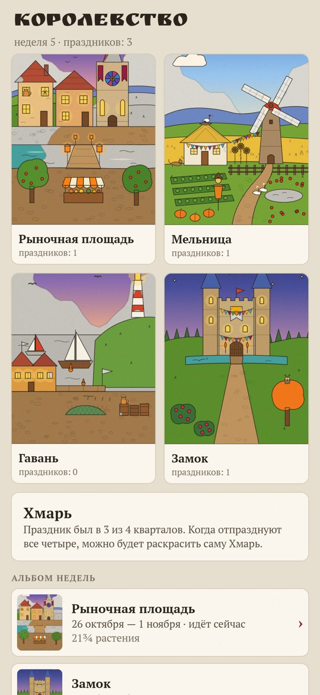

# Красильня

### Тридцать растений в неделю раскрашивают выцветшее королевство

*Серая Хмарь выпила краски сказочного королевства. Ты ученик красильщика, а краски берутся только из живых растений: каждое новое растение на тарелке отдаёт свой пигмент, и квартал недели оживает акварелью поверх туши. Тридцать разных растений за неделю — и квартал устраивает праздник. Без калорий, весов и запретов. Бесплатно, без рекламы, аккаунта и интернета.*

[English](README.md) · **Русский** · [Изменения](CHANGELOG.md)

    

**[Скачать APK](https://github.com/bigdevwhale/dyer/releases/latest/download/Dyer.apk)** · Android 9+

---

## Как это устроено

1. **Одна трапеза — одна отметка.** Выбираешь всё, что было на тарелке, и один раз отвечаешь, сколько тарелки занимали растения: четверть, половина или почти всё. От этого зависит кисть.
2. **Каждое растение красит свою вещь.** Помидор — черепицу, черника — вечернее небо, лук зажигает окна, гречка и чечевица кладут мостовую. Красок семь: красная, оранжевая, жёлтая, зелёная, синяя, белая и земляная.
3. **Капли и побелка.** Травы и пряности идут по четверти, белый рис и белый хлеб — по половине. Кефир, квашеная капуста и другое квашеное закрепляют краски недели.
4. **Тридцать за неделю.** По наблюдению проекта American Gut у тех, кто ест больше 30 разных растений в неделю, микрофлора разнообразнее. В трудную неделю можно взять малую кисть на 15.
5. **Восемь проб.** Нелюбимое растение можно взять в работу: его краска начинает мутной и светлеет с каждой трапезой, ведь к новому вкусу обычно привыкают за 8–15 проб.
6. **Тихая трапеза.** Телефон экраном вниз, ешь не спеша — каждые двадцать минут кисть дорисует деталь: кошку в окне, гусей у пруда.
7. **Полка и королевство.** Каждое съеденное растение стоит банкой на полке; гильдия советует три сезонных растения нужного цвета; книга красильщика открывает настоящие опыты на кухне. Четыре квартала сменяют друг друга по неделям, а когда все отпразднуют, можно раскрасить саму Хмарь.

## Лицензия

MIT. Шрифты: PT Serif, Ruslan Display и Caveat (SIL OFL).
